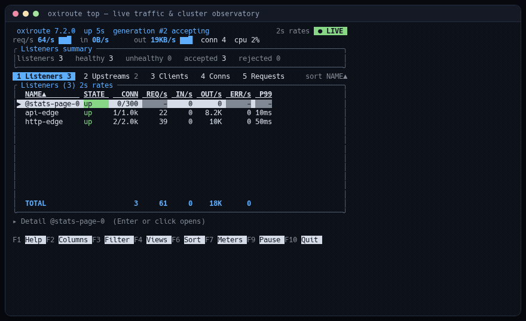
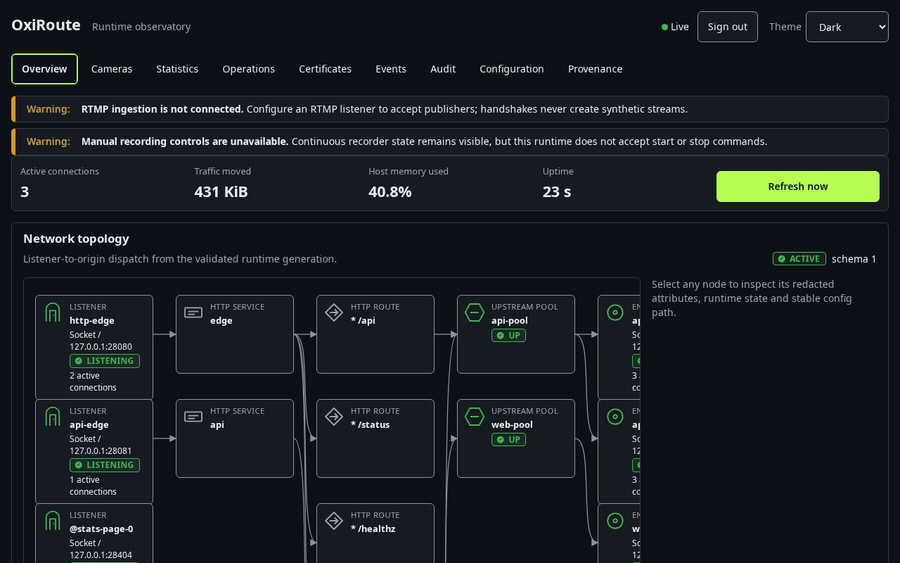

# OxiRoute

A Rust proxy and control plane for routing HTTP, TCP, UDP, and RTMP services from one typed configuration.
Built on [Cloudflare Pingora](https://github.com/cloudflare/pingora), with a CLI and browser dashboard for
inspecting traffic, managing backends, and applying configuration changes.

**Version 7.2.0 · Apache-2.0**

Start with a local evaluation. Protocol support and migration coverage vary by feature; the
[compatibility matrix](docs/COMPATIBILITY.md) defines the current boundaries. Broad production readiness
and complete compatibility with other proxies have not been established.

### Live TUI (`oxiroute top`)

<p align="center">
  
</p>

### Management Web UI & Stats Page

<p align="center">
  
</p>

## Start here

| Your task | Guide |
| --- | --- |
| Run your first reverse proxy | [Getting started](docs/user/GETTING_STARTED.md) |
| Operate listeners, backends, and reloads | [Operations](docs/user/OPERATING.md) · [Runbook](docs/user/RUNBOOK.md) |
| Inspect the dashboard | [Dashboard](docs/user/DASHBOARD.md) |
| Migrate an existing proxy configuration | [Migration](docs/user/MIGRATION.md) |
| Publish or record live streams | [RTMP](docs/user/RTMP.md) |
| Build an integration | [CLI](docs/reference/CLI.md) · [API](docs/reference/API.md) · [Configuration](docs/reference/CONFIGURATION.md) |
| Contribute code | [Developer guide](docs/developer/README.md) |
| Evaluate performance | [Benchmarks and evidence](docs/BENCHMARKS.md) |

## What you can do

| Area | Available behavior | Current boundary |
| --- | --- | --- |
| HTTP routing | Host/path/method routes; proxy, redirect, fixed and static responses; WebSocket upgrades; header rules, gzip, access logs | HTTP/1, HTTP/2, HTTP/3 and gRPC have different conformance limits |
| Backend pools | Round robin, weighted round robin, least connections, health checks, capacity admission, safe retries, passive health, lease-based server registration | Registration requires an opted-in existing pool; retry safety depends on request policy |
| Transport | Opaque TCP with half-close and timeouts; bounded UDP sessions; TLS termination and verified upstream TLS | UDP and supervised active-traffic drain have remaining gates |
| Forward proxy | Authenticated HTTP/1 forwarding and CONNECT, classic H2 CONNECT, bounded H3 forwarding, opt-in H1 CONNECT-UDP | Request forms and MASQUE support are limited; destination policy is explicit |
| Caching | Bounded memory/persistent GET/HEAD caches, revalidation, collapsed fills, authenticated purge | Eligibility and protocol limits apply; broader cache conformance remains |
| Configuration | KDL 2.0, restricted Lua, HOCON and UCI; typed validation, templates, native references, revision-checked saves | KDL is recommended; each adapter has explicit restrictions |
| Operations | CLI, dashboard, topology, Prometheus metrics, events, redacted audit/access logs, reload and rollback | Management is loopback-only with bearer authentication; active-traffic evidence varies by protocol |
| Media | RTMP publish/play, fanout, recording, HLS/DASH, VOD, relays and local controls | Recording supports legacy AVC/AAC; broader media compatibility remains partial |
| Migration | nginx, HAProxy, Apache, Squid and Varnish reports and previews; strict nginx-RTMP composition | Importers accept audited subsets and report blocking semantics |

Feature availability does not imply complete protocol support. Read the
[compatibility matrix](docs/COMPATIBILITY.md) before choosing a listener or replacing an existing service.
Managed ACME also remains partial: CA-staging and production active-traffic evidence are release gates.

## First local request

Follow [Getting started](docs/user/GETTING_STARTED.md) for a complete, copyable source-build tutorial.
It starts a local origin, validates the checked-in configuration, runs OxiRoute, and checks:

```sh
curl -i http://127.0.0.1:8080/healthz
```

Expected result: `200 OK` from the origin through OxiRoute. The full example also configures TCP, RTMP,
and the management dashboard; the guide explains the ports, token, verification, and cleanup.

Source builds use **Rust 1.97.1**, **Node.js 22**, **pnpm 11.3.0**, a C toolchain, and the platform build
prerequisites described in the guide. Linux provides the fullest monitoring and supervision support.

## Install a release

Each [GitHub release](https://github.com/brauliobo/oxiroute/releases) attaches Debian, RPM and Arch Linux packages,
binary tarballs for `x86_64` and `aarch64`, and one `SHA256SUMS`. There is no hosted apt, yum or pacman repository yet; install the
file you downloaded, after `sha256sum --check --ignore-missing SHA256SUMS`:

```sh
sudo apt install ./oxiroute_<version>_amd64.deb                   # Debian 12/13, Ubuntu 22.04/24.04
sudo dnf install ./oxiroute-<version>-1.el9.x86_64.rpm            # AlmaLinux and Rocky Linux 9
sudo dnf install ./oxiroute-<version>-1.amzn2023.x86_64.rpm       # Amazon Linux 2023
sudo pacman -U ./oxiroute-<version>-1-x86_64.pkg.tar.zst          # Arch Linux
```

The packages enable and start nothing; [Install a release package](docs/user/INSTALL.md) has the aarch64 names, the
tarball, the service opt-in, and upgrade, remove and purge behavior. For Arch Linux, see the
[Arch packaging guide](packaging/arch/README.md).

## How configuration changes work

```text
source → typed configuration → validation → prepared generation → active listeners
```

OxiRoute prepares a complete candidate before publishing it. A rejected candidate leaves the active
generation serving. Revision checks prevent a stale configuration editor from silently overwriting a
newer file. Existing traffic retains its generation while it drains; protocol-specific replacement
and drain limits are documented in the [operations contract](docs/OPERATIONS.md).

Start with [configuration examples](docs/reference/CONFIGURATION.md), then consult the
[full specification](docs/CONFIG_SPEC.md) for defaults, bounds, precedence and validation rules.

## Measured performance

A **maintainer-recorded evaluation of the 7.1.0 release** (measured 2026-11-19 on the published profile-guided x86_64
binary, tarball SHA-256 `b002f507...1d651`, against nginx 1.30.7 and HAProxy 3.4.8) reported these medians for an
HTTP/1.1 reverse proxy with a 1 KiB response:

| Measure | OxiRoute 7.1 | nginx | HAProxy |
| --- | ---: | ---: | ---: |
| Requests/second | 182,364 | 134,242 | 118,436 |
| p99 latency, µs | 265 | 402 | 388 |
| Proxy CPU time/request, µs | 5.4 | 7.3 | 8.4 |

One worker per proxy, 32 keep-alive connections, loopback, CPU pinning, interleaved runs on a shared host; two 4-second
measured runs after 2-second warm-ups. OxiRoute 7.0 measured 178,396 requests/second on the same lane in the 7.0 pass
under stricter run acceptance. This workload put OxiRoute above nginx and HAProxy in throughput. Other workloads differ.
The [7.1 report](benchmarks/reports/7.1/README.md) holds the full tables, the 7.1 against 7.0 comparison and the
regressions; the [7.0 report](benchmarks/reports/7.0/README.md) has the earlier figures.

The matrix below lists every scope measured for 7.1.0: the shipped PGO x86_64 binary on a 16-core desktop CPU, pinned
CPUs, loopback, 4-second runs after 2-second warm-ups, measured 2026-11-19 ([7.1
report](benchmarks/reports/7.1/README.md); ranges, PSI and run counts in [docs/BENCHMARKS.md](docs/BENCHMARKS.md)).
Every number is the median of at least two clean runs of the same method, except the single-run cells noted below.
**Clean** means PSI `some` avg10 below 10% with no request errors and a valid scheduler trace; foreign CPU work was
recorded but not used to separate runs, so these rows are not strictly comparable with the 7.0 rows. Cells are
requests/second / p99 µs unless a row says otherwise.

Single-run cells (one clean run): two workers with 256 connections (all columns), HTTP/2 over TLS POST 1 KiB (all
columns, and the nginx HTTP/2 over TCP value in the HTTP/3 POST row), TCP relay echo of 1 KiB and 64 KiB, the eight
feature rows from 2 KiB request headers to basic authentication, the four HTTP/3 rows against HAProxy, the four
instruction-count harness rows, the lossy-path download, and the reload memory row. These late rows were measured on the
same host with the same pinned CPUs and one 4-second run after a 2-second warm-up per cell (PSI `some` avg10 at most
0.7%, no request errors; valid scheduler trace for the comparison-harness rows; foreign work on the pinned CPUs reached
0.9 CPUs).

HTTP/1.1, 1 KiB response and 32 connections unless stated:

| Test | OxiRoute default (epoll) | OxiRoute tokio | OxiRoute io_uring | nginx | HAProxy |
| --- | ---: | ---: | ---: | ---: | ---: |
| Keep-alive, 32 connections | 182,364 / 265 | 141,597 / 358 | 165,783 / 352 | 134,242 / 402 | 118,436 / 388 |
| Keep-alive, 256 connections | 175,485 / 2,855 | 135,568 / 3,640 | 172,429 / 1,946 | 129,207 / 3,657 | 103,392 / 6,345 |
| Keep-alive, 1,024 connections | 170,322 / 16,724 | 124,590 / 154,772 | 136,781 / 24,369 | 76,857 / 38,066 | 69,628 / 33,422 |
| Keep-alive, 2,048 connections | 135,808 / 29,842 | 126,411 / 339,596 | 123,889 / 31,108 | 60,529 / 66,409 | 56,160 / 87,526 |
| 64 KiB response | 92,895 / 664 | 52,540 / 1,265 | 54,644 / 1,572 | 35,234 / 1,636 | 37,533 / 1,618 |
| 1 MiB response | 4,666 / 18,222 | 3,683 / 23,692 | 3,034 / 15,051 | 1,876 / 31,987 | 2,875 / 22,445 |
| New connection per request | 91,826 / 676 | 76,158 / 868 | 86,100 / 734 | 65,484 / 868 | 61,530 / 875 |
| POST 1 KiB | 172,832 / 336 | 137,322 / 448 | 154,714 / 373 | 121,477 / 506 | 115,117 / 468 |
| POST 64 KiB | 43,645 / 1,457 | 36,902 / 1,815 | 36,699 / 2,114 | 30,250 / 1,886 | 30,554 / 2,067 |
| Two workers, 64 connections | 324,356 / 404 | 258,129 / 456 | 299,490 / 489 | 262,650 / 424 | 212,406 / 588 |
| Two workers, 256 connections | 350,108 / 1,635 | 274,482 / 1,434 | 336,451 / 1,548 | 265,540 / 1,928 | 221,293 / 1,550 |

In 7.0 the default epoll plane at two workers was bimodal: later runs from one process kept all connections on one worker
thread (about 181,000 requests/second) and trailed nginx. In this 7.1 pass the default used both worker threads (1.89
and 1.97 of 2 CPUs) and led nginx at two workers; whether the code, the run order or the host explains the change was
not isolated. The tokio plane at two workers produced request errors: 10 of 12 attempts at 64 connections were
discarded, and all 16 attempts of the first 256-connection invocation, so that cell was measured once more with one
run per column.

Worker scaling, epoll plane, 1 KiB response (`aged_per_worker` is an opt-in `connection_scheduling` mode):

| Test | OxiRoute default (epoll) | OxiRoute `aged_per_worker` | nginx | HAProxy |
| --- | ---: | ---: | ---: | ---: |
| One worker, 512 connections | 175,370 / 6,754 | 168,104 / 6,695 | 114,182 / 10,065 | 91,907 / 18,811 |
| One worker, 2,048 connections | 142,400 / 22,354 | 142,243 / 19,642 | 62,593 / 62,798 | 57,789 / 114,897 |
| One worker, 512 connections, 1 in 500 origin responses delayed 200 ms | 167,645 / 4,704 | 146,542 / 12,422 | 104,596 / 19,176 | 89,354 / 17,484 |
| Two workers, 64 connections | 324,356 / 404 | 303,178 / 538 | 262,650 / 424 | 212,406 / 588 |
| Two workers, 256 connections (single run) | 350,108 / 1,635 | 333,219 / 2,376 | 265,540 / 1,928 | 221,293 / 1,550 |
| Two workers, 512 connections | 331,811 / 4,106 | 322,758 / 4,995 | 251,002 / 3,287 | 196,840 / 6,601 |
| Two workers, 1,024 connections | 316,118 / 11,932 | 308,543 / 10,058 | 183,250 / 13,860 | 156,846 / 9,858 |
| Two workers, 2,048 connections | 253,178 / 31,770 | 256,805 / 24,692 | 133,134 / 22,204 | 108,102 / 37,208 |
| Two workers, 512 connections, 1 in 500 origin responses delayed 200 ms | 306,397 / 4,302 | 306,507 / 3,263 | 242,702 / 4,836 | 195,216 / 6,744 |
| Four workers, 64 connections | 336,284 / 388 | 332,812 / 380 | 343,714 / 395 | 344,694 / 389 |
| Four workers, 256 connections | 338,358 / 2,062 | 343,993 / 1,886 | 364,879 / 1,811 | 370,925 / 1,928 |
| Four workers, 512 connections | 332,304 / 7,118 | 338,865 / 6,924 | 333,178 / 7,024 | 356,338 / 5,896 |
| Four workers, 1,024 connections | 292,146 / 19,782 | 294,485 / 20,139 | 305,694 / 19,448 | 292,757 / 18,612 |
| Four workers, 2,048 connections | 271,710 / 46,788 | 280,740 / 45,236 | 279,324 / 43,870 | 240,320 / 40,766 |
| Four workers, 512 connections, 1 in 500 origin responses delayed 200 ms | 312,834 / 5,820 | 309,254 / 6,350 | 317,714 / 5,948 | 342,854 / 3,998 |

HTTPS and HTTP/2 over TLS, one worker, many connections (the TLS listener runs the tokio path; `aged_per_worker` is the
opt-in scheduling mode):

| Test | OxiRoute default | OxiRoute `aged_per_worker` | nginx | HAProxy |
| --- | ---: | ---: | ---: | ---: |
| TLS 1.3 keep-alive, 512 connections | 108,326 / 67,306 | 101,444 / 16,156 | 73,604 / 25,256 | 60,712 / 33,126 |
| TLS 1.3 keep-alive, 1,024 connections | 107,192 / 160,426 | 77,329 / 44,846 | 55,849 / 40,466 | 50,045 / 40,574 |
| TLS 1.3 keep-alive, 2,048 connections | 94,124 / 345,364 | 69,512 / 108,131 | 39,107 / 102,342 | 37,063 / 158,692 |
| HTTP/2 over TLS, 128 connections of 4 streams | 106,750 / 40,462 | 91,974 / 22,778 | 81,130 / 15,952 | 72,582 / 12,623 |
| HTTP/2 over TLS, 256 connections of 4 streams | 94,526 / 118,672 | 86,672 / 29,558 | 58,952 / 37,791 | 55,558 / 41,562 |
| HTTP/2 over TLS, 512 connections of 4 streams | 101,104 / 235,542 | 70,369 / 81,505 | 51,606 / 76,764 | 49,104 / 122,558 |

TLS, 32 connections, ECDSA P-256, rustls. The `io_uring` plane does not serve TLS: with `http_data_plane = "io_uring"`
the TLS listener runs the tokio path, so the table has no `io_uring` column.

| Test | OxiRoute default | OxiRoute tokio | nginx | HAProxy |
| --- | ---: | ---: | ---: | ---: |
| TLS 1.3 keep-alive, 1 KiB | 127,919 / 449 | 123,312 / 426 | 94,787 / 524 | 84,884 / 712 |
| TLS 1.2 keep-alive, 1 KiB | 125,382 / 474 | 130,119 / 392 | 98,830 / 573 | 87,748 / 626 |
| TLS 1.3 full handshake | 14,960 / 6,352 | 15,256 / 4,294 | 4,939 / 13,716 | 4,394 / 9,062 |
| TLS 1.2 ECDHE full handshake | 17,268 / 4,132 | 17,384 / 3,430 | 5,178 / 12,710 | 4,832 / 9,653 |
| TLS 1.3 resumed (ticket) | 16,290 / 4,736 | 15,513 / 6,226 | 5,325 / 8,119 | 4,786 / 7,704 |
| TLS 1.2 resumed (ticket) | 53,804 / 1,130 | 54,232 / 1,172 | 11,736 / 4,733 | 8,856 / 7,010 |
| TLS 1.2 resumed (session id) | 54,438 / 1,382 | 55,112 / 1,578 | 12,102 / 4,406 | 9,095 / 5,718 |
| TLS 1.3 full handshake, RSA-2048 certificate | 1,934 / 31,693 | 1,878 / 35,594 | 1,612 / 22,068 | 1,538 / 29,684 |
| TLS 1.3 full handshake with a client certificate | 5,286 / 13,155 | 5,246 / 13,326 | 2,820 / 16,261 | 2,626 / 20,946 |

With `http_data_plane = "epoll"` set explicitly, the TLS 1.3 keep-alive 1 KiB lane reaches 153,674 / 388 (OxiRoute option;
the default listener runs the tokio path).

HTTP/2 over TLS, 8 connections of 4 streams; the `io_uring` plane does not serve these front ends either:

| Test | OxiRoute default | OxiRoute tokio | nginx | HAProxy |
| --- | ---: | ---: | ---: | ---: |
| 1 KiB | 130,661 / 486 | 134,110 / 392 | 98,260 / 608 | 80,351 / 906 |
| 64 KiB | 28,646 / 2,608 | 28,834 / 2,326 | 17,723 / 4,072 | 20,327 / 3,013 |
| POST 1 KiB | 113,983 / 490 | 110,957 / 586 | 67,226 / 1,116 | 72,437 / 666 |

Upstream HTTP/2: an HTTP/1.1 front end with 32 connections and an HTTP/2 upstream.

| Test | OxiRoute default (epoll) | OxiRoute tokio | OxiRoute io_uring | nginx | HAProxy |
| --- | ---: | ---: | ---: | ---: | ---: |
| 1 KiB | 38,719 / 1,602 | 37,028 / 1,720 | 37,230 / 1,676 | 81,740 / 823 | 81,526 / 690 |
| POST 1 KiB | 29,766 / 2,120 | 31,867 / 1,763 | 30,134 / 1,924 | 72,552 / 878 | 81,580 / 791 |

With an HTTP/2 upstream OxiRoute serves about half the requests/second of nginx and HAProxy; with an HTTP/1.1 upstream it
is ahead of both.

Cache hits and compression, 32 connections. nginx and HAProxy compress per request and have no stored-coding cache:

| Test | OxiRoute default | OxiRoute tokio | OxiRoute io_uring | nginx | HAProxy |
| --- | ---: | ---: | ---: | ---: | ---: |
| 1 KiB cache hit | 270,691 / 218 | 270,568 / 212 | 271,036 / 196 | 126,682 / 439 | 183,402 / 315 |
| 64 KiB cache hit | 101,339 / 824 | 99,514 / 877 | 99,528 / 849 | 94,573 / 831 | 55,102 / 1,294 |
| 64 KiB gzip level 1, stored coding, hit (nginx and HAProxy compress per request) | 132,603 / 458 | 135,128 / 425 | 130,332 / 434 | 43,540 / 1,122 | 25,449 / 3,246 |
| 64 KiB gzip level 1, no cache | 30,464 / 1,914 | 30,924 / 2,176 | 32,676 / 1,411 | 34,090 / 1,924 | 21,773 / 3,787 |

Stored brotli and zstd codings, 64 KiB, level 1, cache hit, 32 connections. The nginx and HAProxy builds measured have no
brotli or zstd encoder, so these lanes run on OxiRoute only:

| Test | OxiRoute default | OxiRoute tokio | OxiRoute io_uring |
| --- | ---: | ---: | ---: |
| zstd | 162,700 / 574 | 199,708 / 384 | 184,269 / 466 |
| brotli | 127,424 / 494 | 133,634 / 460 | 122,526 / 524 |

HTTP/3, one worker, loopback, comparison harness. The `cubic` column is the same OxiRoute listener with
`http3_congestion_control = "cubic"`:

| Test | OxiRoute `bbr` (default) | OxiRoute `cubic` | nginx HTTP/3 | nginx HTTP/2 over TCP |
| --- | ---: | ---: | ---: | ---: |
| Proxy, 8 connections of 4 streams, 1 KiB | 65,808 / 1,440 | 69,843 / 862 | 62,538 / 1,066 | 98,260 / 608 |
| Direct 1 KiB response | 174,649 / 444 | 177,235 / 354 | 117,212 / 578 | 165,690 / 404 |
| Proxy POST 1 KiB | 62,298 / 831 | 55,711 / 1,790 | 57,158 / 998 | 67,226 / 1,116 |
| New QUIC (HTTP/2: new TLS) connection per request, direct | 4,908 / 4,140 | 5,018 / 3,771 | 3,240 / 4,868 | 5,192 / 2,434 |

HTTP/3 against HAProxy, one run per cell, the three proxies measured back to back in one invocation (HAProxy listens with
`bind quic4@... alpn h3`). OxiRoute used 1.2 to 1.5 CPUs of its two and nginx and HAProxy 0.99. The OxiRoute and nginx
figures are single runs of the same lanes as above, 8% to 19% higher than their medians there:

| Test | OxiRoute `bbr` (default) | nginx HTTP/3 | HAProxy HTTP/3 |
| --- | ---: | ---: | ---: |
| Proxy, 8 connections of 4 streams, 1 KiB | 78,228 / 555 | 71,224 / 490 | 81,112 / 430 |
| Direct 1 KiB response | 206,328 / 190 | 132,687 / 348 | 138,789 / 1,267 |
| Proxy POST 1 KiB | 67,386 / 653 | 66,052 / 528 | 92,546 / 468 |
| New QUIC connection per request, direct | 5,542 / 2,293 | 3,622 / 2,280 | 3,250 / 3,719 |

Lossy path, 40 ms round trip, 0.5% loss, one 10 MiB download in seconds (lower is better; single run, one fresh
connection, user and network namespace with `netem`, QUIC segmentation offload off; HAProxy serves no files from disk and
is not part of this lane):

| OxiRoute `bbr` (default) | OxiRoute `cubic` | nginx HTTP/3 | nginx HTTP/2 over TCP |
| ---: | ---: | ---: | ---: |
| 0.357 | 13.112 | 30.967 | 2.664 |

Static files, 32 connections. HAProxy does not serve files from disk, so this table has no HAProxy column:

| Test | OxiRoute default | nginx |
| --- | ---: | ---: |
| Static file 1 MiB | 1,516 / 44,110 | 1,546 / 36,988 |
| Static file 1 MiB over TLS 1.3 (OxiRoute kernel TLS, nginx user-space TLS) | 1,378 / 36,862 | 706 / 68,006 |
| Static file 1 KiB | 318,252 / 222 | 75,598 / 862 |

Other protocols and features, 32 connections unless stated. nginx and HAProxy verify the bcrypt hash on every request,
which is why the basic authentication row shows 26 requests per second for both:

| Test | OxiRoute default | nginx | HAProxy |
| --- | ---: | ---: | ---: |
| WebSocket echo, 1 KiB message, 16 connections | 174,132 / 158 | 220,462 / 132 | 179,158 / 150 |
| TCP relay echo, 1 KiB, 16 connections | 203,425 / 151 | 219,786 / 87 | 184,368 / 153 |
| TCP relay echo, 64 KiB, 16 connections | 78,700 / 373 | 36,437 / 545 | 26,120 / 1,485 |
| Pool `least_connections`, 8 servers | 170,064 / 348 | 132,066 / 394 | 113,108 / 492 |
| Pool `weighted_round_robin`, 8 servers | 179,268 / 316 | 126,428 / 457 | 107,705 / 672 |
| HTTP/1.1 keep-alive, 1 connection | 38,276 / 47 | 35,296 / 54 | 32,088 / 60 |
| HTTP/1.1, 2 KiB request headers | 138,878 / 389 | 99,170 / 424 | 104,974 / 428 |
| Access log on | 173,218 / 316 | 92,536 / 388 | 79,786 / 491 |
| Request id on | 187,179 / 220 | 126,170 / 447 | 106,459 / 424 |
| Request and response header rules | 187,342 / 207 | 140,287 / 257 | 115,243 / 383 |
| 1,000 exact routes plus a catch-all | 187,168 / 211 | 140,877 / 262 | 119,250 / 382 |
| 4 origin servers, round robin | 187,035 / 212 | 140,047 / 277 | 120,160 / 373 |
| Literal 301 redirect, no upstream | 397,412 / 107 | 302,965 / 171 | 264,907 / 232 |
| Basic authentication, bcrypt cost 10, same credentials every request (OxiRoute does not run bcrypt per request) | 88,168 / 520 | 26 / 1,213,719 | 26 / 2,226,800 |

OxiRoute only, instruction-count harness, 16 connections, 1 KiB. nginx and HAProxy have no equivalent of the breaker,
outlier ejection and capacity admission of the first row, and no forward-proxy configuration was written for them (nginx
answers `CONNECT` with 405):

| Test | OxiRoute default |
| --- | ---: |
| Reverse proxy with 7 production features on | 154,355 / 193 |
| Forward proxy, HTTP/1.1 absolute-URI request | 39,742 / 517 |
| Forward proxy, CONNECT tunnel echo | 173,693 / 137 |
| Forward proxy, new CONNECT tunnel per request | 25,291 / 844 |

Memory, one worker (PSS in MB from the comparison harness, medians of three processes; incremental resident memory per
idle connection in bytes, 5,000 connections, HTTP/2 1,000, medians of two runs). The reload row is one run per proxy
(`benchmarks/r2-data-path/reload_memory.py`: summed PSS of the process tree, one worker, OxiRoute through the management
API, nginx `SIGHUP`, HAProxy `SIGUSR2`; the idle values of that configuration are 33.1, 12.8 and 27.0 MB):

| Test | OxiRoute | nginx | HAProxy |
| --- | ---: | ---: | ---: |
| PSS idle, MB | 11.5 | 11.0 | 31.2 |
| PSS, 32 connections held / drained, MB | 12.1 / 12.1 | 11.2 / 11.2 | 31.6 / 31.7 |
| PSS, 1,024 connections held / drained, MB | 13.8 / 13.8 | 20.4 / 20.4 | 41.8 / 40.4 |
| PSS after 1 / 10 / 50 configuration reloads, 1,001-route configuration, MB | 36.3 / 37.1 / 33.8 | 20.4 / 20.7 / 21.3 | 24.8 / 26.2 / 25.0 |
| Per idle HTTP/1.1 keep-alive connection, bytes | 1,777 | 9,903 | 10,944 |
| Per idle HTTP/1.1 connection over TLS, bytes | 18,326 | 34,805 | 36,070 |
| Per idle WebSocket connection, bytes | 12,520 | 18,372 | 6,484 |
| Per idle WebSocket connection over TLS, bytes | 21,642 | 59,830 | 30,178 |
| Per idle HTTP/2 over TLS connection, bytes | 27,852 | 48,758 | 47,796 |

Not covered: RTMP and arm64 binaries.

These are summary records: the raw runs and the complete reproducibility
bundle are not published here. They cannot serve as an independently validated release baseline or
production sizing guarantee. [Benchmark evidence](docs/BENCHMARKS.md) includes ranges, additional
workloads, memory measurements, caveats and the requirements for a publishable comparison.

## Develop

Begin with the [developer guide](docs/developer/README.md) for setup, the crate map, architecture and
focused verification. Runtime changes need failure-path and interoperability evidence, along with updates
to the relevant user guide and capability status.

Typical Rust checks, from the repository root:

```sh
nice cargo +1.97.1 fmt --all --check
nice cargo +1.97.1 clippy --workspace --all-targets --locked --jobs 4 -- -D warnings
nice cargo +1.97.1 test --workspace --locked --jobs 4
```

The [testing guide](docs/developer/TESTING.md) covers UI, browser, contract, fuzz and protocol checks.
The [documentation hub](docs/README.md) connects tutorials, operational guides and exact references.

## License

[Apache License 2.0](LICENSE). Vendored dependencies retain their upstream licenses and document
provenance and local changes in their own directories.
