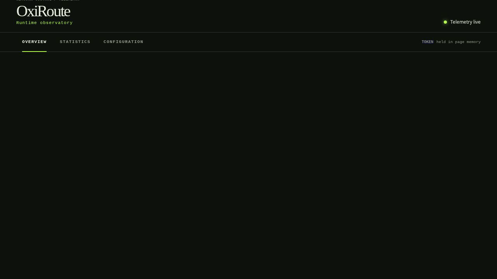
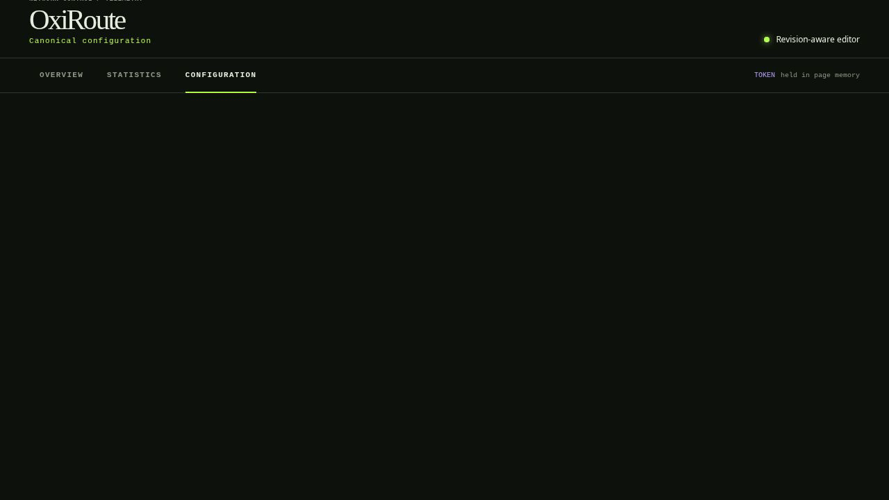

# Dashboard Guide

The management UI is a build-time Vue 3 (Vapor mode) application with Pug templates. It is served
from the configured `management.ui_dir`; it is not a separate remote SaaS console. It needs no inline
styles or scripts, so it also runs behind a strict `default-src 'none'; script-src 'self';
style-src 'self'; connect-src 'self'` Content-Security-Policy set by a fronting proxy.



The GIF is a deterministic product walkthrough rendered by Remotion. It uses representative data,
not a production daemon or secret-bearing screenshot.

## View Map

| View | What it answers | Data source |
| --- | --- | --- |
| **Overview** | Is the process, listener, origin pool, topology, or RTMP catalog healthy? | Monitoring, topology, and RTMP catalog snapshots |
| **Statistics** | What are the process, listener, backend, queue, and server counters? | The active runtime monitoring snapshot |
| **Operations** | What can be drained, reloaded, rolled back, or changed administratively? | Authenticated generation and runtime action APIs |
| **Certificates** | Which imported, Certbot, or managed identities are active and what lifecycle actions are available? | Authenticated TLS inventory and job APIs |
| **Events** | What bounded operational events are available now? | The non-durable event ring and SSE delivery |
| **Audit** | What redacted control operations were durably retained? | Authenticated durable audit history and status |
| **Configuration** | What is on disk, what is active, and what would a typed draft render as? | Authenticated config API and candidate validation |
| **Provenance** | Which native reports, blockers, requirements, and canonical fields were retained? | Authenticated redacted import-report API |

## Overview

The overview has four reading levels:

1. The header state says whether telemetry is live, synchronizing, stale, or offline.
2. The readout bar shows active connections, total traffic, host memory, and uptime.
3. The monitoring panels show aggregate traffic, host pressure, process resources, and RTMP activity.
4. Listener rows, upstream pools, topology, and active stream cards expose the entity-level evidence.

When a refresh fails, the UI retains the last valid monitoring sample and labels it stale. It does
not replace a failed sample with fabricated zeroes. An endpoint in `unknown` state is not treated as
healthy; health-enabled pools begin unavailable until their checks establish eligibility.

## Topology Inspector

Select a node in the topology schematic to inspect:

- stable ID and canonical config path;
- redacted configuration attributes;
- runtime state and active connection overlays;
- the typed relation to listeners, services, routes, pools, and endpoints.

Certificate private-key paths, recording roots, token paths, and other sensitive paths are excluded
or redacted. The topology endpoint is an active-generation view; configuration validation exposes a
separate candidate topology marked `not_active`.

## Statistics

Statistics is intentionally dense. On a narrow screen, use the horizontal table scroll or move back
to Overview for summary cards. Counters with potentially large `u64` values arrive as decimal strings
so JavaScript does not lose precision. Current gauges and bounded configuration counts remain JSON
numbers.

The table distinguishes:

- runtime state from administrative state;
- observed health from an operator health override;
- configured connection capacity from a runtime override;
- successful and failed checks from consecutive transition streaks;
- active queue depth from cumulative queue totals.

## Stats Page

The stats page is the read-only dashboard of a `stats.pages[]` listener, for operators who have no
management token. Open the page's `uri_prefix` in a browser, for example `http://192.0.2.10:8404/stats`.
It needs no sign-in, so it is shown to everyone who can reach that listener: keep it on a trusted
interface or loopback. It shows addresses, binds, revisions, certificate names and warnings.

The page refreshes itself. The status line under the title says **Live**, **Paused**, **Stale**,
**Retrying**, **Unavailable** or **Unsupported version**, and how long ago the data was updated. When a
refresh fails or goes stale, the page keeps the last values, marks them, and says why in a banner; it
never replaces them with zeros. **Unsupported version** means the proxy was upgraded to a format this
page does not know: reload the page.

### What it shows

- **Overview strip.** Version and uptime, generation, connections, request rate and error share,
  traffic in and out, pools and servers up, listeners ok, the certificate closest to expiry, and the
  number of warnings (a link to them).
- **Listeners.** Name, state, connections, request rate, bytes in and out, errors and latency.
  Expanding a listener lists its bind, protocol, service, TLS profile, relay pool, connection counters, outcomes and cache counters.
- **Routes.** The selectors, action and pool of each route, with a link to the pool.
- **Pools and servers.** One table per pool, with the pool status, how many servers are available,
  the algorithm and the queue. Each server row shows status, sessions, request rate, bytes, response
  classes (1xx to 5xx), errors, check result, weight, downtime and latency. Expand a pool or a server
  for its address, origin, administrative state, health override, check and passive-ejection counters,
  attempts by outcome, a latency histogram and sparklines. A pool or server whose status changed in the
  last 10 seconds is marked "status changed".
- **Generation.** The active, candidate, previous, on-disk and quarantined revisions, counters, the last
  failure or rejection, and replaced generations that still drain.
- **Process.** CPU, memory, threads, file descriptors, in-flight upstream requests and host load.
- **Certificates.** Expiry of each certificate, its source and last renewal outcome, and the renewal
  watchers.
- **Warnings.** Configuration warnings of the running generation, with their codes.

### Status words

Every status is a word and a shape, so it reads without colour: **UP** (check mark in a circle),
**DOWN** and **EJECTED** (cross in an octagon), **DRAIN** (exclamation in a triangle), **MAINT**
(diamond), **UNCHECKED** and **UNKNOWN** (dash in a circle). `UNCHECKED` is a server with no health
checks. `EJECTED` is a server removed by passive health after failing requests. A pool shows **UP**
when all its servers are available, **DEGRADED** when some are, **DOWN** when none is, and **EMPTY**
when it has no servers. A server counts as a problem unless it is `UP` or `UNCHECKED`.

### Rates and percentiles

Request, error and byte rates are per second, computed in the browser from the counters of two
consecutive samples. The first sample, a proxy restart, a new generation, or a long gap in samples
has no rate, so the cell shows an em dash instead of zero. A zero means the counter did not move.
Sparklines keep the samples of this visit only; reloading the page starts them empty. Unknown points
are gaps.

Latency percentiles (p50, p90, p99) are read from the proxy's lifetime histograms. Each value is the
upper bound of its bucket, so read "at most N ms"; a value shown with `>` is above the last bucket.
They describe everything since the proxy started, not the last minute. An em dash means there are no
observations yet. Sizes, counts and durations are shortened (1.2M, 3.4 GiB); hover a value for the
exact number.

### Filters, sort and view

- **Search** narrows pools, servers and listeners to rows containing every word you type (name,
  address, status, protocol and so on).
- **Status chips** show only servers in the chosen statuses. **Problems only** keeps the rows that need
  attention.
- **Sort** by name, status (worst first), sessions, request rate, errors, p99 latency, bytes in or
  bytes out: click a column header, or use the Sort menu on a phone.
- **Pause** stops the refresh and keeps what is on screen; **Refresh now** loads once, also while
  paused. **Refresh every** chooses 1, 2, 5, 10, 30 or 60 seconds, or follows the interval the proxy
  suggests (`refresh_ms`, at least 1 s).
- **Theme** is automatic (your system), light or dark.
- Filters, sort, interval, pause, theme and the open rows are kept in the address bar, so copy the
  address to share the view. Nothing secret is in it.

### Shortcuts and export

Press `?` for the list. `/` focuses the search, `p` pauses or resumes, `r` refreshes now, `t` changes the
theme, `f` toggles problems only, and `Esc` clears the search or closes a dialog. Shortcuts do not act
while you type in a field.

The header links download the data: **CSV** (HAProxy-style columns, for spreadsheets and scripts) and
**JSON** (the full snapshot). Printing the page gives a plain light copy of the data without the
controls. The page works on narrow screens (rows become cards) and with high-contrast and
reduced-motion settings.

### Without JavaScript

A browser with scripts disabled shows a plain table of pools and servers (administrative state, health
and active connections) that reloads itself at the refresh interval.

### Administration buttons

When the page is configured with `admin = "localhost"` and you open it from the same machine, an
Administration section lets you choose a pool and a server and set it to **Ready**, **Drain** or
**Maintenance**. Each change asks for confirmation and then reports the result. If the configuration
changed since the page loaded, the change is refused, the page refreshes, and you can try again.
Everyone else, and every page with `admin = "disabled"`, gets the read-only page. The same forms work
in the no-JavaScript table.

## Configuration Workspace



The workspace deliberately follows a review flow:

```text
unlock -> load disk revision -> edit typed fields -> server validate -> inspect preview/topology -> save
```

Important states:

- **Disk revision:** the exact authored root bytes used as the save precondition.
- **Active revision:** the effective generation currently serving traffic.
- **Candidate revision:** the fully prepared draft, which may not be active yet.
- **Compositional root:** a KDL/HOCON/UCI source that uses templates or native references; it is
  inspectable and validatable but typed save is disabled so source declarations are not flattened.
- **Stale draft:** the file changed outside the UI; the UI preserves the draft and requires an
  explicit discard/reload decision.

The preview is rendered by the backend in the root's authored format. The browser does not generate
Lua, KDL, HOCON, or UCI source itself.

For a `weighted_round_robin` pool, the configuration workspace exposes one bounded integer weight
per server and keeps the weight list aligned when servers are added or removed. Native source files
remain read-only.

## Audit And Provenance

The Audit view reads the separate durable redacted control-history store. It supports category/result
filters, cursor pagination, persistence status, and degraded-store warnings. It never substitutes the
non-durable Events view when the durable route is unavailable.

The Provenance view reads retained native import reports through the authenticated API. It shows
redacted source graphs, blockers, requirements, diagnostics, canonical field origins, and finalized
read-only KDL previews. It does not rewrite native files or activate standalone reports.

## RTMP Controls

Active stream cards show publisher identity, audience, codec observations, media totals, relay state,
and recorder phases. Manual recorder buttons are available only when:

- a publisher is currently attached;
- the active configuration contains a manual recorder;
- the observed media is a supported legacy AVC/AAC FLV combination; and
- no conflicting start/stop transition is already running.

Continuous recorders remain observable but are not manually toggled. Recorder names shown in the UI
are relative names; the configured recording root is never sent to the browser.

## Access And Accessibility

The management token is entered into the page and held in memory. It is not stored in cookies,
localStorage, the URL, or the generated dashboard GIFs. The UI uses labeled controls, keyboard-focus
states, non-color status labels, responsive detail panels, and explicit loading/stale/error states.

For the exact route and authentication contract, read [API_UI_SPEC.md](../API_UI_SPEC.md).
